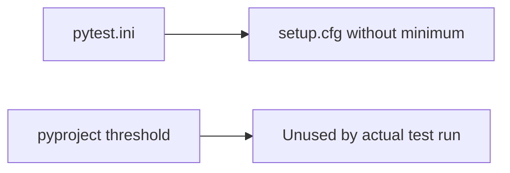
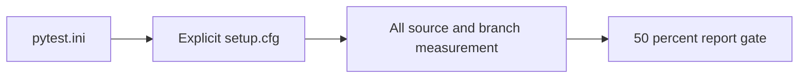
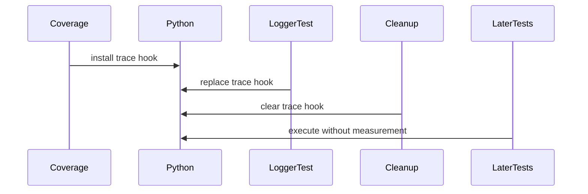
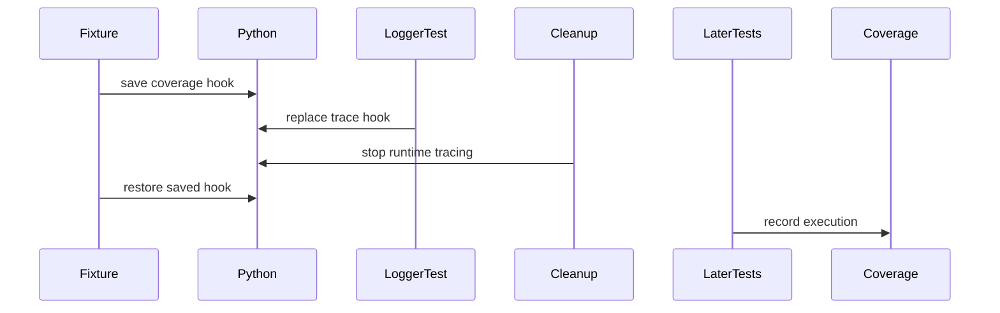

# Coverage configuration precedence (#252)

Pytest selected `pytest.ini`, so the addopts in `pyproject.toml` never ran.
Coverage selected `setup.cfg`, whose source was misspelled `mclili` and whose
report section had no minimum. CI supplied `--cov=src/mcli`, correcting the
source but leaving the minimum unset. A passing functional test run therefore
did not prove the documented 50% coverage gate.

`pytest.ini` now explicitly selects `setup.cfg`, starts coverage on all of
`src/mcli` and preserves the existing collection settings and markers.
`setup.cfg` owns branch measurement, the unchanged active exclusions and the
50% report minimum. Duplicate inactive pytest and coverage sections were removed.
Focused development runs can explicitly opt out with `--no-cov`; release runs
must measure the entire source tree.

The regression invokes the real coverage CLI against a temporary module. The
unexercised branch produces coverage below 50% and a failing report exit status;
exercising both branches produces a successful report. The test overrides the
source only for its temporary fixture and does not alter the release denominator.
Existing behavior tests also exercise the LSH client through mocked HTTP session
boundaries, checking request payloads and authentication, error propagation,
connection ownership and subscriber isolation.

**Before**

**After**

The coverage uplift in #178 is separate acceptance work. Configuration tests
passing cannot substitute for a full-package measurement at or above 50%.

A second harness defect made the initial full measurement incomplete. Logger
tests replace the active interpreter trace hook; their cleanup sets it to None.
The autouse cleanup fixture stopped the logger but did not restore coverage's
previous hook. The next tests passed while execution went unrecorded. A regression
now checks that an active coverage collector retains a trace hook after logger
cleanup. It failed before fixture repair. Teardown now restores the prior thread
and interpreter hooks. The focused logger/trace/LSH/config run passes 55 tests;
LSH combined coverage rises from 17.73% in the interrupted full measurement to
50.71% when measured after the repaired teardown. This is corrected measurement,
not a claim that new tests alone supplied that increase.

**Before**

**After**

The production ownership defect is tracked separately in #253. Four sentinel-hook
cases failed before the logger fix (one existing no-ownership case passed).
MCLI now snapshots both hooks on the first enable, retains that snapshot through
repeated enables and restores each hook only if its own callback still occupies
that slot. A newer debugger hook remains untouched. The fixture restoration is
retained as test isolation defense. The focused combined regression run passes
60 tests, with the previously lost LSH execution measured.

Final checkpoint measurement: 1,841 passed, 267 skipped; coverage 42.30%,
10,475/22,917 statements and 1,920/6,388 branches. The gate correctly exits 1.
This is 12,395/29,305 combined items; at least 2,258 additional covered items are
needed for 50%. All 2,077 pre-existing node IDs are unchanged. The 31 new cases
are two configuration cases, 24 LSH cases and five logger-ownership cases.
The 60 focused regressions also pass on Python 3.10. No minimum was lowered,
no exclusions were added and no tests were removed or skipped by this change.
