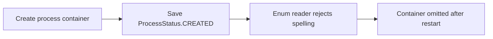
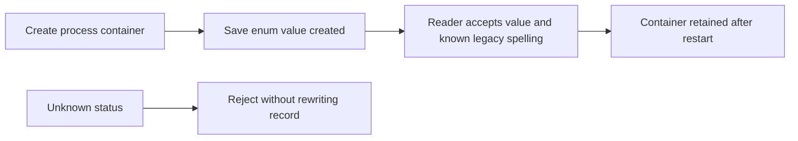

# Process metadata reload (#254)

Creating a process container wrote its status through `json.dump(..., default=str)`.
That produced `ProcessStatus.CREATED`. Reload passed that string to the enum
constructor, whose stored value is `created`; the exception caused the container
to disappear from the manager's catalog.

New metadata writes the enum value explicitly. The reader accepts enum values
and the five known legacy `ProcessStatus.NAME` spellings. Unknown states remain
invalid; the reader does not evaluate strings, invent a replacement status or
rewrite invalid records. Existing known records are retained and normalized by
the ordinary metadata writer.

The regression creates an isolated container and reconstructs the manager from
its actual metadata. It failed before the repair. Sixteen cases now cover new
metadata, every legacy status, invalid status rejection and real owned child
process lifecycle. Those lifecycle cases test captured output, explicit working
directory/environment, duplicate start prevention, graceful stop, forced kill,
SIGTERM escalation and launch failures. Every child belongs to the test's own
new process group and is reaped during the test or fixture cleanup.

**Before**

**After**

