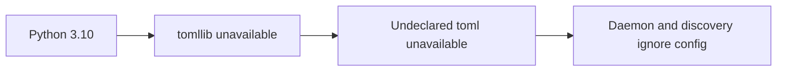
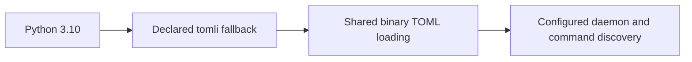

# Python 3.10 TOML parsing (#255)

The package supports Python 3.10 and declares `tomli`. Its TOML utility instead
fell back to undeclared `toml` when builtin `tomllib` was unavailable. Python
3.10 therefore raised an import error. Daemon config loading and command
discovery caught that exception, silently ignoring otherwise valid config.

The supported-runtime run reproduced both caller failures: local daemon config
did not override defaults and configured command discovery produced an empty
catalog. Forced fallback on Python 3.11 also reproduced two utility failures,
while two native-parser cases passed.

The utility now selects builtin `tomllib` or declared `tomli`, then shares one
binary-mode file load. No dependency or lock changes are needed. Regression
cases cover UTF-8 and nested values, absent keys, invalid syntax, missing files
and permission failures. Parser and file errors still propagate to the caller.
The existing daemon/discovery assertions remain and pass after the repair.

**Before**

**After**

