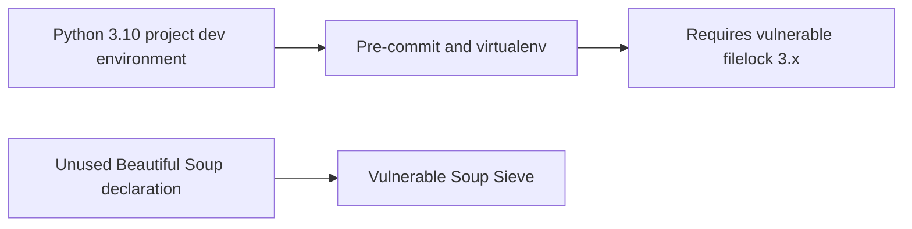
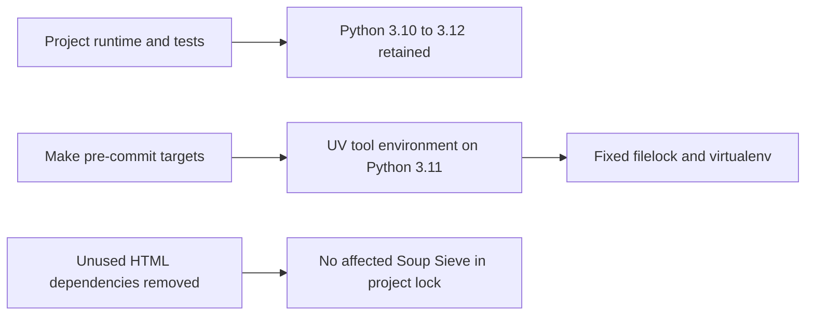
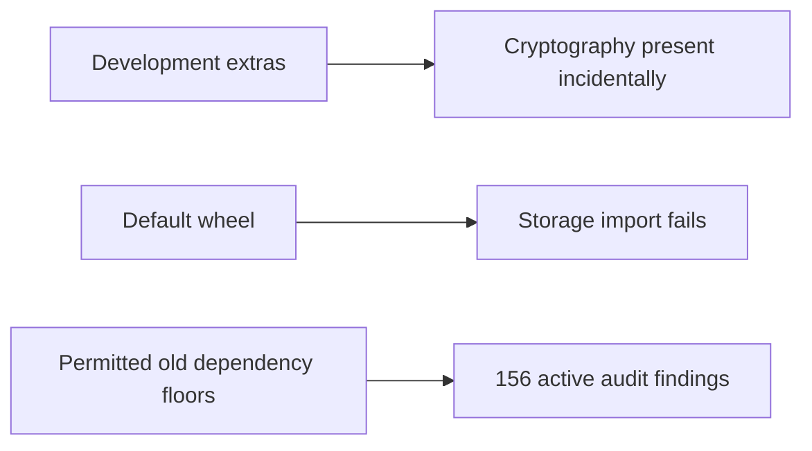
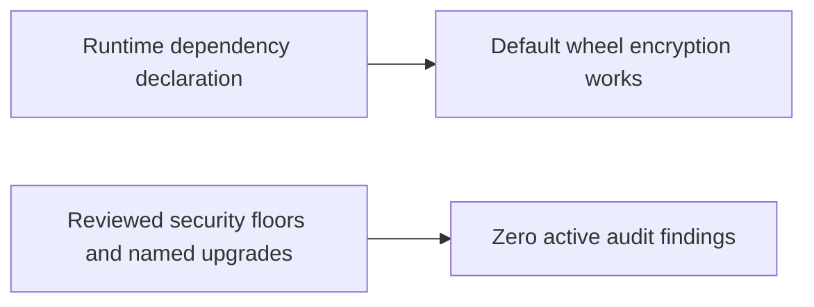

# Dependency security and default-wheel encryption

Issue: #251. Integration release: 8.0.71, not yet published.

## Review correction

The initial Safety-only clean result below was not a release approval. PR #256's
Dependency Review identified eight Authlib advisories; the critical empty-JWS
signature bypass was still present in 1.6.12. A regression with a valid signed
control reproduced acceptance of an unsigned payload. Authlib is now at least
1.9.5, beyond the advisory fixed versions 1.9.0 and 1.9.1. The signed control
continues to verify and an empty signature list is rejected.

Auditing the actual exported frozen development set independently with pip-audit
found 46 findings across eight further packages after the Authlib repair. Named
upgrades address aiohttp, Black, certifi, GitPython and Pylint. Beautiful Soup and
Soup Sieve had no callers in owning source, tests, scripts or workflows; their
unused declarations are removed, including legacy requirements files. The
documentation's optional pentest instructions still explicitly install their
own dependencies.

Fixed filelock 4.2.1 requires Python 3.11. Secure virtualenv versions require
filelock at least 3.24.2. An attempted older pin, 3.20.3, avoided some advisories
but still had two findings; GHSA-69hj-f68j-2879 affects every version through
4.2.0. Keeping pre-commit/virtualenv or Safety in the Python 3.10 project
environment was therefore unsatisfiable with those security requirements. The
three existing Make pre-commit targets use UV's isolated tool runner on Python
3.11 with fixed dependency floors. Runtime and test Python support remain intact.
No owning source used Safety, virtualenv or filelock. Pre-commit remains available
through the existing Make targets. Project runtime/development exports and the
isolated pre-commit environment are audited separately.

Safety's compatible filelock-4 environment selected Safety 3.2.3, but the actual
scanner failed before scanning: current Typer no longer exports `rich_utils`.
A bounded Typer/Click compatibility attempt then failed because Safety imports
`pkg_resources`, removed from the required fixed setuptools release. No unsafe
dependency override was used. The existing `security-check` target retains
Bandit and now runs pip-audit on a fresh frozen project dependency export;
the hosted dependency-audit job uses the same route. Scanner failures propagate,
and the former advisory-ignore fallback is removed. A vulnerable Authlib fixture
exercises the actual scanner's failure exit, separately from clean interpreter
exports and the Make failure-propagation regression.

The Make regression executes each target against a recording UV command and
checks interpreter selection, security floors and preserved arguments; the three
pre-commit cases and the dependency-audit case failed before their runner changes. Final audit and test results must correspond
to the resulting frozen lock and all three supported interpreters.

**Before**

**After**

Primary references: [Authlib empty-signature advisory](https://github.com/authlib/authlib/security/advisories/GHSA-6v38-4h7w-rj9h),
[Soup Sieve affected versions](https://github.com/advisories/GHSA-mmhr-3c5m-f64f),
[filelock affected versions](https://github.com/advisories/GHSA-v4x8-3wr5-3wq8),
[virtualenv 21.14.9 dependency metadata](https://pypi.org/pypi/virtualenv/21.14.9/json),
[filelock 4.2.1 Python requirement](https://pypi.org/pypi/filelock/4.2.1/json).

## Initial checkpoint, superseded for release approval

The project development environment reproduced 156 active Safety advisories
across 19 packages, with zero ignores. Matching tuples on main establish that
the shell exit-status fix did not introduce them; baseline provenance does not
waive the security gate.

The repair raises the affected runtime and development floors and uses named
UV upgrades. FastAPI 0.133.0 permits the fixed Starlette 1.3.1. Black 26.3.1
requires the development upper bound to move to 27; its formatting-only changes
are included. Cryptography 50 and virtualenv 21 cross major versions, so package
metadata alone is insufficient evidence of supported behavior.

The default wheel also omitted `cryptography`, despite storage and secrets
modules importing it. A fresh default-wheel installation reproduced
`ModuleNotFoundError: No module named 'cryptography'`. The regression builds the
wheel, installs it with runtime dependencies only into an isolated UV environment,
and verifies a binary encryption round trip and the installed API health route.
The test asserts that pytest is absent from that runtime environment. Declaring
cryptography as a runtime dependency makes the regression pass.

**Before**

**After**

After frozen development installation, Safety reports 184 packages, zero active
advisories and zero ignored advisories. No policy exceptions were added. The
configured HIGH-severity Bandit filter is separate from the unfiltered report;
this dependency repair does not eliminate pre-existing raw source findings.
Coverage configuration and the documented 50 percent threshold remain separate
integration requirements (#252 and #178).

## Dependency versions

| Package | Before | After |
|---|---|---|
| aiohttp | 3.13.3 | 3.14.3 |
| anyio | 4.12.1 | 4.14.2 |
| authlib | 1.6.6 | 1.6.12 |
| black | 25.12.0 | 26.3.1 |
| cryptography | 46.0.4 | 50.0.0 |
| fastapi | 0.128.0 | 0.133.0 |
| gitpython | 3.1.46 | 3.1.62 |
| idna | 3.11 | 3.15 |
| multidict | 6.7.1 | 6.9.1 |
| nltk | 3.9.2 | 3.10.4 |
| pydantic-settings | 2.12.0 | 2.14.2 |
| pygments | 2.19.2 | 2.20.0 |
| pyjwt | 2.10.1 | 2.15.0 |
| pytest | 9.0.2 | 9.0.3 |
| python-dotenv | 1.2.1 | 1.2.2 |
| requests | 2.32.5 | 2.33.0 |
| soupsieve | 2.8.3 | 2.9 |
| starlette | 0.50.0 | 1.3.1 |
| urllib3 | 2.6.3 | 2.8.0 |
| virtualenv | 20.36.1 | 21.7.13 |

Resolution also updates filelock and pathspec and adds python-discovery and
defusedxml to satisfy the updated tools. Other existing versions stay locked.

## Publisher evidence

All target releases have published files and Python requirements compatible with
3.10 in their PyPI JSON metadata. Maintainer advisories and release notes explain
the security boundaries; the fresh audit verifies the combined installed set.

- [Black advisory, fixed in 26.3.1](https://github.com/psf/black/security/advisories/GHSA-3936-cmfr-pm3m)
- [Starlette form-limit advisory, fixed in 1.3.1](https://github.com/Kludex/starlette/security/advisories/GHSA-82w8-qh3p-5jfq)
- [FastAPI 0.133.0 dependency declarations](https://github.com/fastapi/fastapi/blob/0.133.0/pyproject.toml)
- [Cryptography changelog](https://github.com/pyca/cryptography/blob/main/CHANGELOG.rst)
- [Virtualenv activation advisory](https://github.com/pypa/virtualenv/security/advisories/GHSA-p58f-9548-mpm2)
- [Pydantic Settings 2.14.2 security release](https://github.com/pydantic/pydantic-settings/releases/tag/v2.14.2)
- [Pytest 9.0.3 security fix](https://github.com/pytest-dev/pytest/releases/tag/9.0.3)
- [Pygments changelog](https://github.com/pygments/pygments/blob/master/CHANGES)

## Validation

- Baseline Safety: 182 packages, 156 active findings, zero ignored; exit 64.
- Repaired Safety: Python 3.11, 184 packages; Python 3.10, 188 packages. Both
  report zero active findings, zero ignored, exit 0.
- Full functional suite: 1,810 passed, 267 skipped, 12 warnings, exit 0.
- Focused encryption, daemon API, API utilities and shell-loader suite: 44 passed
  on Python 3.10 and 3.11. The final wheel regression with API health validation
  also passed separately on both interpreters.
- Frozen install, lock check, Black, isort, flake8, mypy (217 source files), wheel
  and sdist builds, and configured HIGH-severity Bandit: exit 0.
- The 18 existing Python files changed by Black have identical parsed ASTs before
  and after formatting. No source behavior was changed by the formatter.
- Virtualenv 21.7.13 creates a working isolated Python interpreter.

Starlette warns that its HTTPX TestClient adapter is deprecated. The adapter
still passes the exercised routes; no HTTP client migration is included here.
These checks do not satisfy the separate coverage gate or authorize publication.
