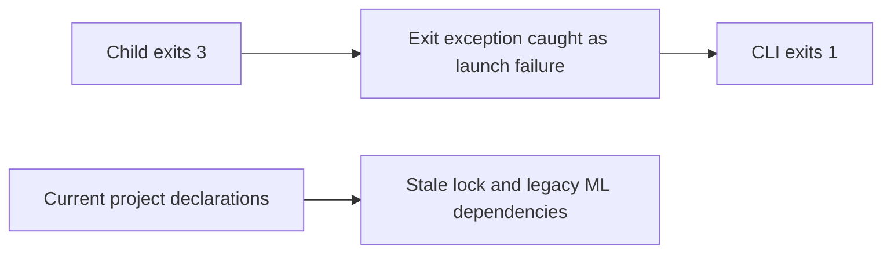
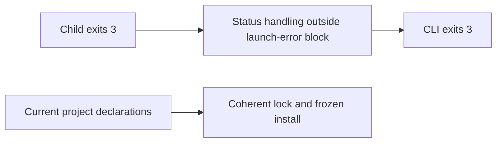

# Shell workflow exit status

Issue: #249.

`Context.exit()` raises Click's `Exit`, which derives from `Exception`. Calling
it inside the shell wrapper's process-launch `try` block sent ordinary nonzero
child exits through the launch-error handler. That handler changed the status to
`1` and printed an execution error.

The wrapper now handles the child status after the launch-error block. Tests run
real shell scripts with exit codes `0`, `3` and `17` through both execution modes.
A separate launch-failure test preserves the existing error path.

Observed RED: four failures and two passes before the implementation. Focused
and neighbouring GREEN: 28 tests passed after the implementation.

Release validation also found stale lock metadata (#250): `uv.lock` recorded
version `8.0.43` and dependencies absent from the current project. Frozen sync
therefore selected a legacy ML/CUDA graph. `uv lock --check` failed before a
normal `uv lock` refresh, without `--upgrade`. Frozen sync then succeeded. Check
lock coherence before installing a large frozen environment.

**Before**

**After**

