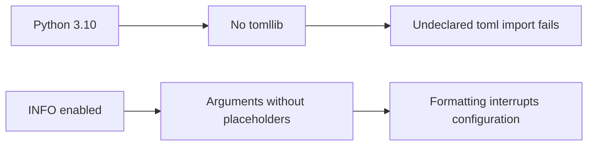
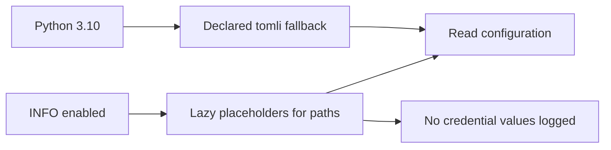

# Clean supported-Python configuration

Issue #265. The clean Python 3.10 suite exposed two existing failures. TOML reads
fell back from unavailable stdlib tomllib to undeclared legacy toml, although
tomli is already a core dependency. Credential-path INFO messages passed values
without logging placeholders; enabling INFO could raise TypeError before normal
configuration operations completed.

Use the declared tomli binary API when tomllib is unavailable. Centralized lazy
logging templates format provider names and paths without logging credential
values. Preserve configuration contents, file locations and permissions.

The full clean 3.10 diagnostic observed 35 failures. New regressions force the
parser fallback even on newer Python and enable INFO while writing, reading and
persisting dummy configuration. Both failed before the change; the corrected
configuration/workflow subset passes all 38 cases. The workflow regression also
checks install-before-export, exact audit input, strict collection, failure
propagation and evidence retention after #264.
The final clean suites each pass 1,807 tests with 267 existing skips on Python
3.10, 3.11 and 3.12; no skip was added to hide these failures.

**Before**

**After**

