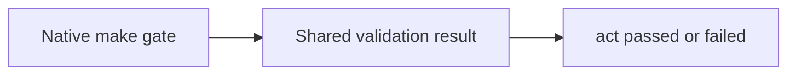
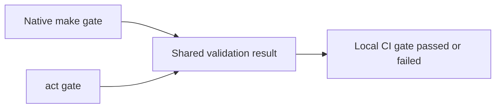

# Native CI outcome reporting

Issue: #262. A native make ci-native gate returned PASS/FAIL through the same enum
as act, but the CLI always described those outcomes as act. This overstated which
runner had executed and made release evidence ambiguous.

Use runner-neutral completion/refusal messages. Keep the preceding runner-specific
command line and all existing exit codes. NOT_VALIDATED still refuses publication;
this wording fix does not turn a skipped or unavailable job into a pass.

Two CLI regressions failed before the change. The corrected gate pass/failure and
PR refusal cases preserve exit 0/1 and reject the misleading act labels. All 55
CI runner tests pass; full gate results belong to the associated PR.

**Before**

**After**

