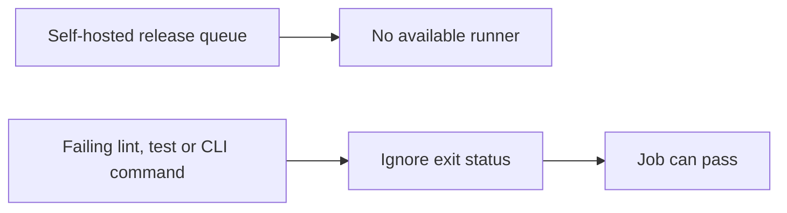
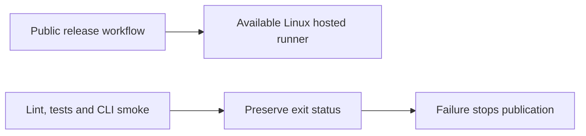

# Available public release validation

Issue #266. The existing public-repository publisher queued on unavailable
self-hosted runners. Native equivalents completed locally, but publication could
not start. Use standard available Linux hosted runners for this existing public
release workflow under the public-repo policy; preserve its triggers and credentials.

Lint, pytest and CLI smoke commands also suppressed failures. Three regressions
execute the actual workflow snippets with check tools that return 23. All three
incorrectly returned 0 before the correction; all now return 23. Source formatting,
full tests and the rebuilt wheel/CLI smoke pass independently.

The exact publisher test-and-coverage command ran locally: 1,807 passed, 267 existing
skips, 12 warnings, exit 0. Whole-tool coverage is about 30%; the active tox coverage
configuration sets a 30% floor. No coverage configuration or threshold is changed,
and this does not claim the broader 80% coverage goal. Updated hosted publisher
checks must pass before merge and publication.

**Before**

**After**

