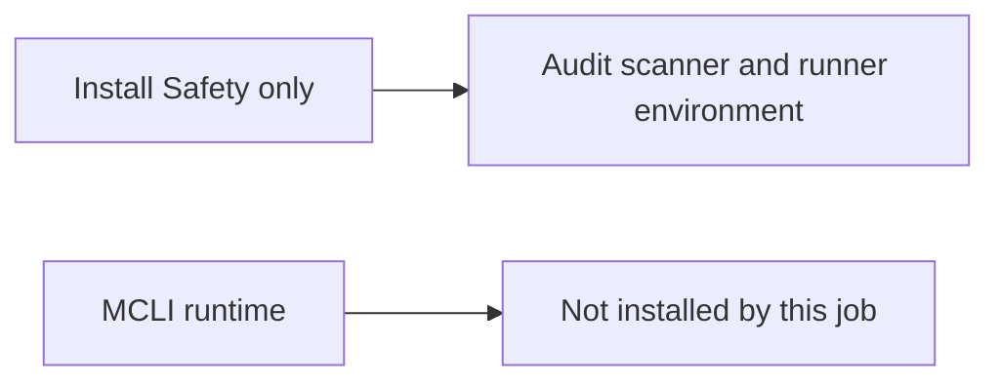
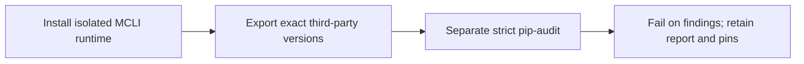

# Audit the installed runtime

Issue #264. The security job installed only Safety, then audited that environment;
it did not install MCLI. In PR #263, the job reported three filelock vulnerabilities
from the scanner environment. Safety 3.8.1 requires filelock >=3.16.1,<4.0, while
the upstream patched line starts at 4.2.1. Do not force an incompatible dependency
or add vulnerability exceptions to make this job pass.

Install MCLI in an isolated Python 3.11 environment. Export every installed
third-party runtime dependency as an exact version, excluding only the editable
first-party project. Run pinned pip-audit separately with strict collection,
without re-resolving dependencies or ignoring findings. CodeQL/Bandit cover the
first-party source; dependency-review license policy and lockfile work are separate.
Optional/dev environments are not certified by this runtime audit.

The first integration attempt showed that strict auditing of an editable path
rejects the first-party package. The exported pinned list avoids that ambiguity.
The corrected local integration audited 78 runtime dependencies, found no known
vulnerabilities, and exited 0; the installed 79-package environment also passes
`uv pip check` (78 dependencies plus MCLI). The JSON report and package list are
uploaded even when the workflow fails. No exit status is suppressed.

References: [pip-audit usage](https://github.com/pypa/pip-audit#usage),
[upstream filelock advisory](https://github.com/tox-dev/filelock/security/advisories/GHSA-8mx5-7m5m-r77g).

**Before**

**After**

