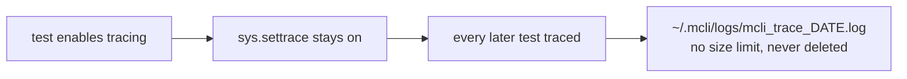
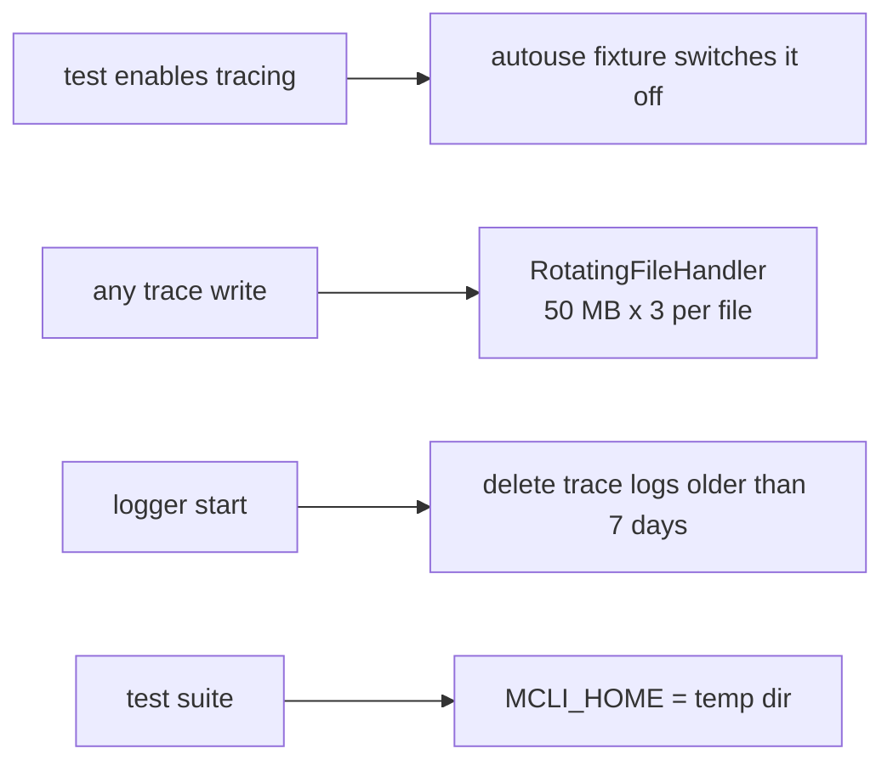

# Release Notes - Version 8.0.68

**Release Date:** 2026-10-28

## Overview

Trace logs can no longer fill a disk. On a CI host, `~/.mcli/logs` held 35 GB of
`mcli_trace_*.log`, up to 13 GB in one day. Two causes:

1. The trace and system-trace logs used a plain `FileHandler` with no size
   limit. Runtime tracing writes one line per Python call.
2. The test suite turned runtime tracing on (`tests/unit/test_logger.py`) and
   never turned it off. `sys.settrace` is process-wide, so every later test was
   traced into the real `~/.mcli/logs`.

## Changes

- `mcli_trace_*.log` and `mcli_system_*.log` rotate at 50 MB and keep 2 backups.
  They are created only when something is traced.
- Trace and system-trace logs older than 7 days are deleted when the logger
  starts. The main `mcli_*.log` is not touched.
- Worst case on disk, with tracing left on: about 2.4 GB in total, instead of
  no limit.
- Overrides: `MCLI_TRACE_LOG_MAX_BYTES`, `MCLI_TRACE_LOG_RETENTION_DAYS`.
  Defaults are in `mcli.lib.constants.defaults.TraceLogs`.
- Tests: `MCLI_HOME` points at a temporary directory, and tracing is switched
  off after every test.
- Fixed: re-enabling system tracing right after disabling it left tracing off,
  because the old worker thread was still asleep.

## Before / After

**Before**

**After**

## Tests

`tests/unit/test_trace_log_cap.py` (8 tests). RED observed on 8.0.67: 399 KB
written against a 20 KB cap, no pruning, an empty trace file on every start,
and the suite's logs in the real `~/.mcli/logs`.
