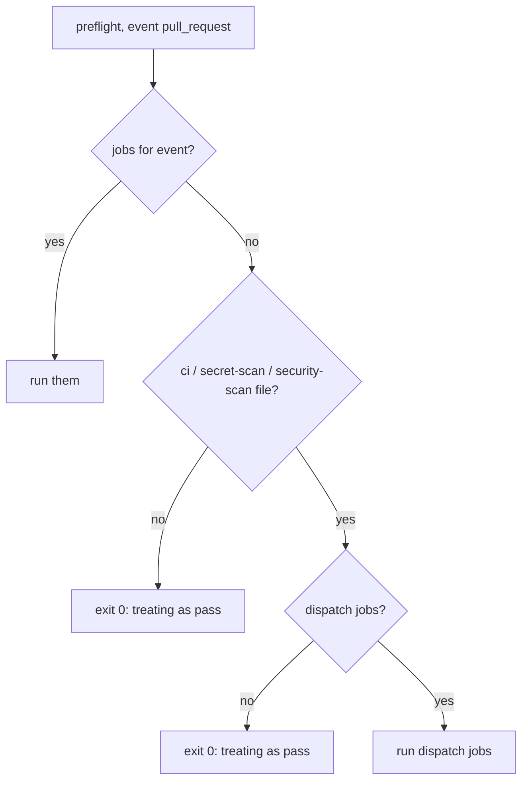
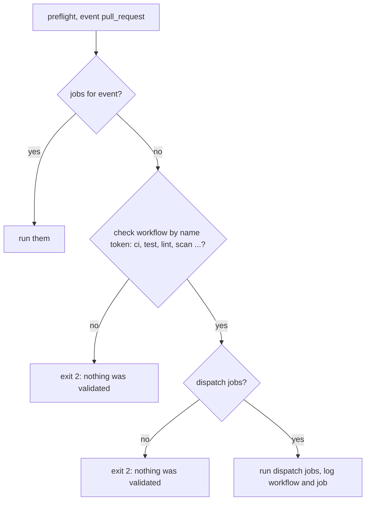

# Release Notes - Version 8.0.68

**Release Date:** 2026-10-28

## Overview

`mcli ci preflight` no longer reports a pass when `act` ran no job (#242).

- The `workflow_dispatch` fallback now runs any check workflow, chosen by name
  token (`ci`, `test`, `lint`, `typecheck`, `check`, `scan`, `security`,
  `quality`, …). Before, it ran only `ci*`, `*-ci`, `secret-scan` and
  `security-scan`, so a dispatch-only `test.yml` was never run.
- Workflows whose name contains `deploy`, `release`, `publish`, `build`,
  `audit`, `ops`, `upload`, `notify` or `sync` are never run.
- When no job ran, `preflight` exits `2` with "nothing was validated" (new
  `PreflightResult.NOT_VALIDATED`). Before, it exited `0`.
- `mcli ci pr` refuses to open a PR on that result.
- The pre-push hook template still allows exit `2`/`3`, but now prints
  `WARNING — this push was NOT validated`. Re-run `mcli ci install-hook` to get it.

## Before / After

**Before**

**After**

## Files changed

- `src/mcli/workflow/ci/act_runner.py` — token-based `dispatch_workflows`,
  `PreflightResult.NOT_VALIDATED`, no hollow pass in `run_act`.
- `src/mcli/workflow/ci/ci.py` — exit `2` for `NOT_VALIDATED` in `preflight`
  and `pr`; hook template warns on exit `2`/`3`.
- `docs/commands/ci.md` — exit-code contract, fallback rule, hook behaviour.
- `tests/unit/workflow/test_ci_act_runner.py`, `tests/unit/workflow/test_ci_cli.py`
  — reproduction with a dispatch-only `test.yml` repo (act mocked at
  `subprocess.run`), selection rule, CLI exit codes, hook warning.
