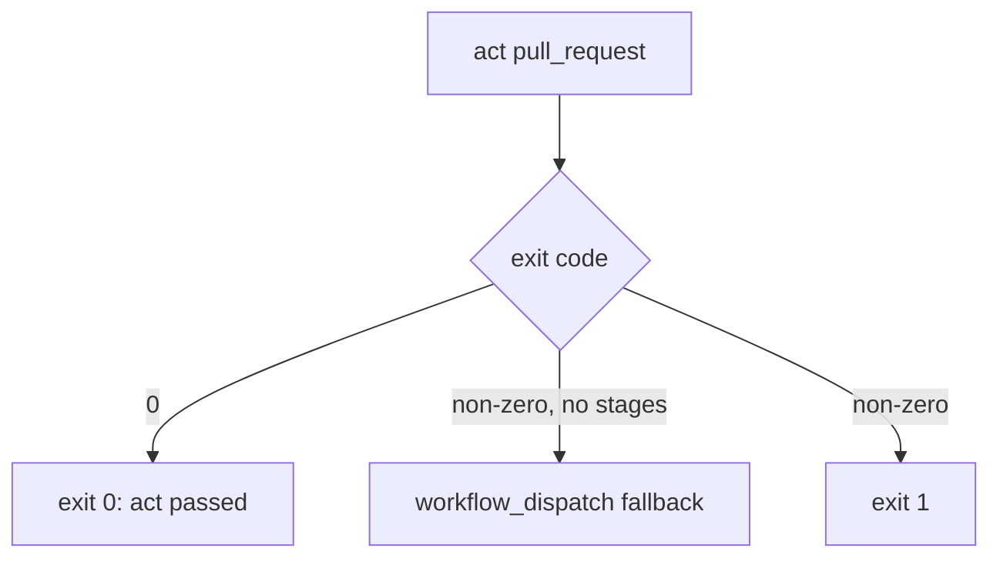
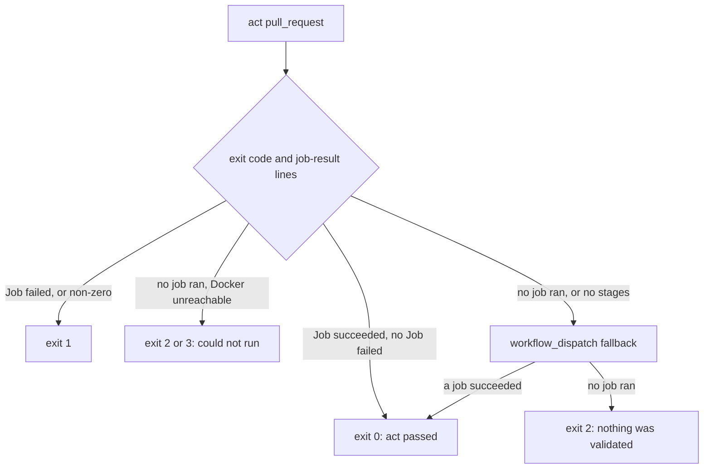

# Release Notes - Version 8.0.70

**Release Date:** 2026-11-09

## Overview

`mcli ci preflight` no longer reports a pass when `act` exits `0` but runs no job (#247).

- In Conduit, `act pull_request` skipped every job (the `same-repo-guard` `if:` and
  the `self-hosted` `runs-on`), exited `0` in about 12 seconds, and preflight printed
  `✅ act passed`. `_run_with_retries` treated exit `0` as PASS.
- A pass now needs at least one `🏁  Job succeeded` line and no `🏁  Job failed` line.
- Exit `0` with no job-result line is "no job ran". Preflight then tries the
  `workflow_dispatch` check workflows. If no job runs there either, it exits `2`
  ("nothing was validated").
- Exit `0` with a `🏁  Job failed` line is a failure (exit `1`).
- Exit `0` with no job ran and a "cannot connect to the Docker daemon" message is
  "could not run" (exit `2`, or `3` when an online runner exists).
- A `workflow_dispatch` job that act skips no longer counts toward a pass.

## Before / After

**Before**

**After**

## Files changed

- `src/mcli/workflow/ci/act_runner.py` — `_job_results`, `_is_docker_unreachable`;
  `_run_with_retries` classifies by job-result lines, not exit code; `run_act`
  falls back on any "no job ran" result.
- `src/mcli/lib/constants/defaults.py` — `ActOutputMarkers` (job-result pattern,
  Docker-unreachable markers).
- `docs/commands/ci.md` — exit-code contract.
- `tests/unit/workflow/test_ci_act_runner.py` — #247 reproduction (exit `0`, only
  the docker-host log line), failed-job, Docker-unreachable, skipped dispatch jobs,
  and an end-to-end CLI test. Tests that used an empty exit-`0` run as a pass now
  supply a `🏁  Job succeeded` line.
