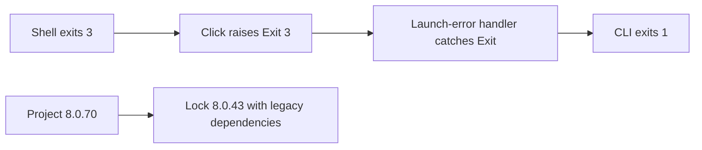
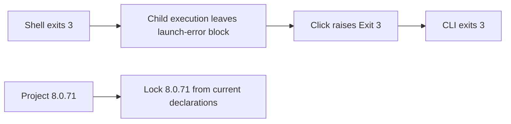

# Release Notes - Version 8.0.71

Release date: 2026-11-13

Shell workflows preserve their child process exit code in captured-output and
interactive execution (#249). A script that exits `3` now returns `3`, without
the misleading execution-error diagnostic. Process-launch failures still return
`1` with the existing diagnostic.

The lockfile is regenerated from the current declarations (#250), removing the
legacy ML/CUDA dependency graph. Its editable package version now matches the
release version. No `--upgrade` resolution was requested.

**Before**

**After**

Changed: shell execution, regression tests, release metadata and installation
documentation. The lockfile is refreshed from the current dependency declarations.
