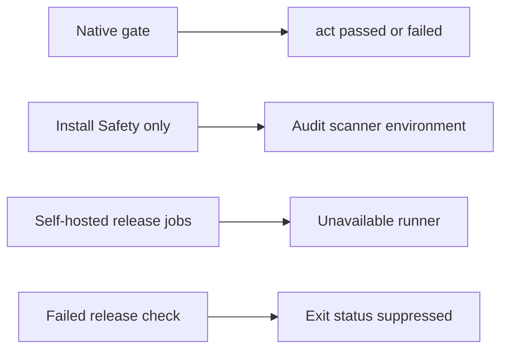
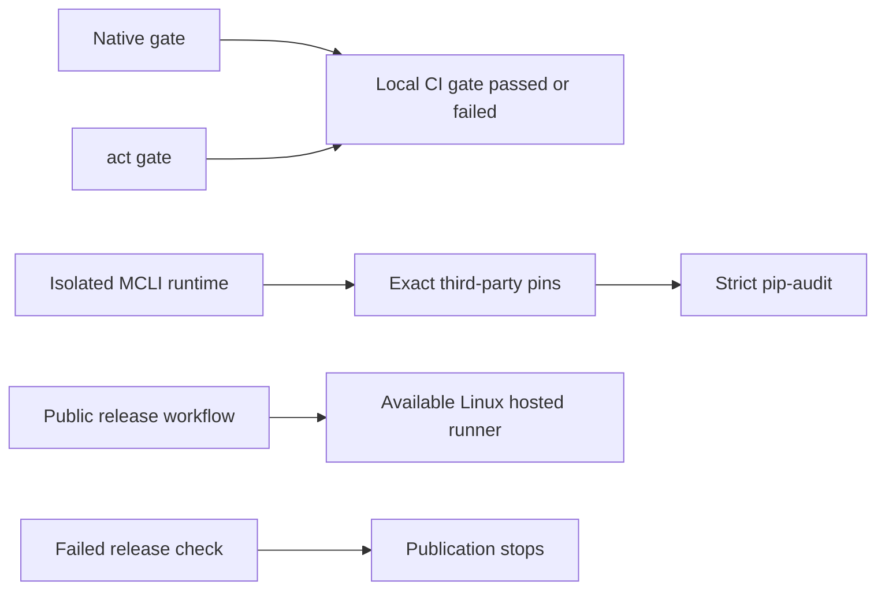

# 8.0.71

Fix CI completion messages that incorrectly called native validation an act run
(#262). PASS/FAIL, PR refusal and all exit codes retain their existing behavior.
Correct the security job to audit the installed MCLI runtime instead of its own
scanner environment (#264). Strict pip-audit checks the exact exported runtime
versions without ignoring findings. No runtime dependency or license-policy change
is included; the separate dependency
candidate in #256 and its policy decision in #259 remain unresolved.

Fix clean supported-Python configuration paths (#265): use declared tomli when
stdlib tomllib is unavailable, and format credential-path INFO logs without
interrupting configuration operations or exposing values. See the paired flow in
[the configuration learning](../learnings/clean-python-configuration.md).

Run the existing public publishing workflow on available Linux hosted runners,
select each declared Python version explicitly, and propagate lint/test/CLI-smoke
failures (#266). The current coverage configuration and triggers are retained.
See [publisher failure propagation](../learnings/public-publisher-failure-propagation.md).

**Before**

**After**

The diff adds centralized runner-neutral messages and CLI regressions. Two cases
failed before the fix. The workflow suite passes 144 tests; the complete existing
clean suite passes 1,807 tests with 267 existing skips on each of Python 3.10,
3.11 and 3.12. Locked Black 25.12.0 and isort
5.13.2 validate the source. The local act attempt stalled fetching CodeQL's action
after a git-clone error and was stopped; it is not a passing act result.
The isolated runtime audit checks 78 dependencies with no known vulnerabilities,
exit 0; all 79 installed packages (including MCLI) pass `uv pip check`.
