# Release Notes - Version 8.0.71

Release date: 2026-11-13

Shell workflows preserve their child process exit code in captured-output and
interactive execution (#249). A script that exits `3` now returns `3`, without
the misleading execution-error diagnostic. Process-launch failures still return
`1` with the existing diagnostic.

The lockfile is regenerated from the current declarations (#250), removing the
legacy ML/CUDA dependency graph. Its editable package version now matches the
release version. The initial metadata refresh used no upgrade resolution; the
security remediation below then applied named package upgrades.

**Before**

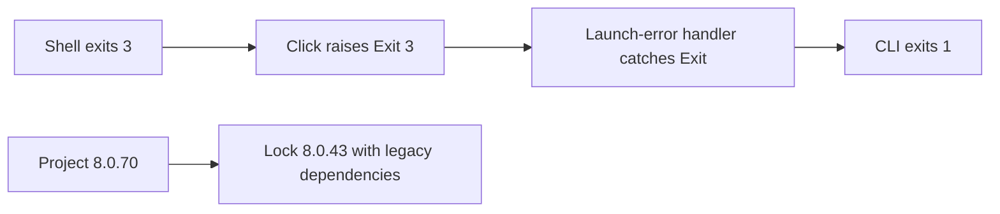

**After**

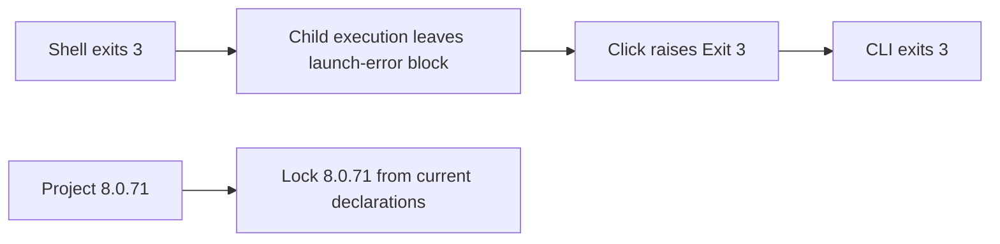

Changed: shell execution, regression tests, dependency security floors, package
metadata, Black formatting, release notes and installation documentation.

Security remediation (#251) updates the 19 packages reported by the project
Safety audit, plus FastAPI to support the fixed Starlette release. Runtime and
development dependency floors prevent resolution back to the audited vulnerable
versions. Black's supported range moves to 26.x; its formatting changes are
included. The release remains Python 3.10 compatible.

`cryptography` is now an explicit runtime dependency. Previously, installing the
default wheel without development extras left encrypted storage unusable. A
regression test builds and installs the wheel in a fresh environment, encrypts
and decrypts binary data, imports the secrets manager, and requests the MCLI API
health endpoint through the installed HTTP stack.

**Before**

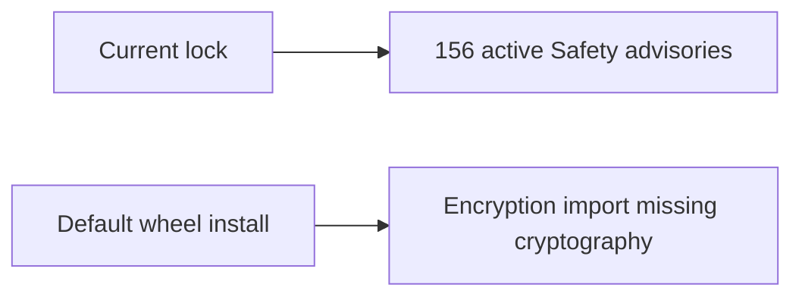

**After**

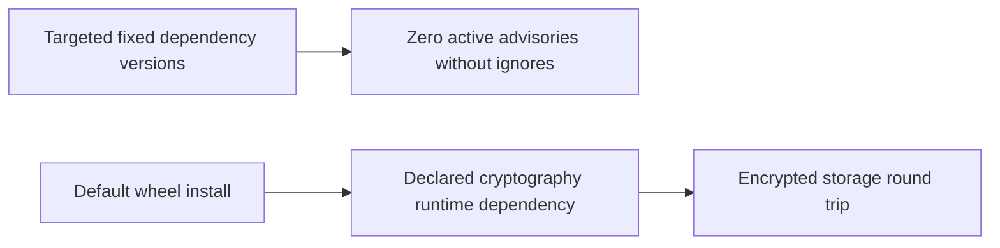

The dependency repair is part of this release, beyond the lock metadata refresh.
Safety scanned 184 installed development-environment packages and reported zero
active advisories and zero ignored advisories. The full functional suite passed
1,810 tests with 267 skips. Python 3.10 frozen installation and focused storage,
API and shell tests also pass. The full matrix and coverage results below
include these dependency repairs.

Coverage configuration repair (#252) makes `setup.cfg` the single coverage
configuration and `pytest.ini` the single pytest configuration. Plain pytest,
Make and CI coverage runs now select whole-package branch measurement and the
50% minimum. The old ordinary CI command did not enforce that minimum. The
existing exclusions and collected tests are preserved. New LSH transport tests
cover authentication, job requests, session ownership and event-handler failures.
The configuration repair is validated by the whole-package measurement below.
The broader core-module coverage work remains tracked under #178.

**Before**

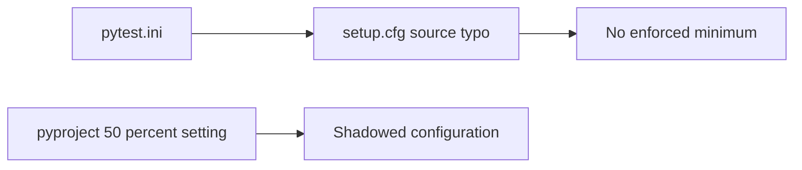

**After**

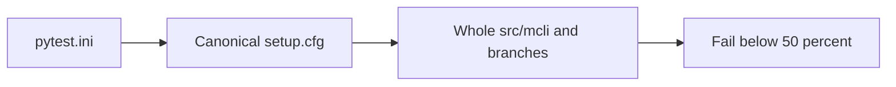

The coverage harness also restores the prior interpreter and thread trace hooks
after logger tests. Previously, logger cleanup cleared coverage's hook and later
tests ran without measurement. A regression reproduces that loss and verifies
that teardown leaves an active collector attached.

Runtime tracing preserves external debugger and coverage hooks (#253). MCLI
saves the prior interpreter and thread hooks once when enabling tracing, then
restores each only if MCLI still owns it. Disabling tracing cannot overwrite a
new tracer that took ownership in the meantime. Five sentinel-hook regressions
cover no ownership, repeated enable/disable and independent hook replacement.

**Before**

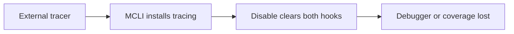

**After**

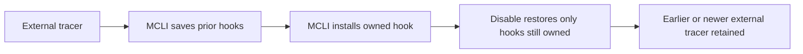

The earlier 1,964-pass run's 50.13% coverage claim was invalid as a whole-source
gate: 15 namespace modules were missing. Counting them reduced the unchanged
saved hit data to 43.992573%. Namespace discovery is now explicit, with a
zero-hit namespace regression and additional behavioral coverage. A fresh
whole-source matrix must pass the unchanged 50% minimum before release; broader
acceptance remains tracked under #178.

Process container metadata now survives manager reload (#254). New records
store enum values such as `created`; known legacy `ProcessStatus.NAME` records
remain readable. Invalid states are rejected without rewriting their records.
A real metadata reload regression reproduced the omission before the fix;
16 lifecycle and persistence cases pass after it.

**Before**

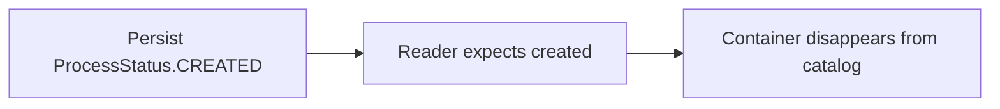

**After**

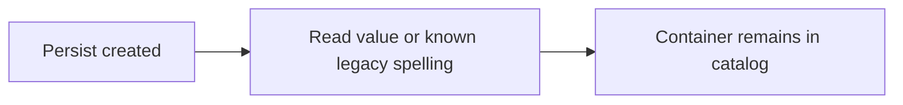

Coverage work under #178 adds public-contract checks for daemon HTTP retries,
command discovery and lazy dispatch, encrypted secrets and local Git recovery,
workspace catalogs, storage cache/network fallback and version discovery,
search ranking and cache failures, pipeline validation and batching, path
precedence, sync CLI outcomes and actionable error diagnostics. External
services use test doubles; encryption, temporary files, repositories and owned
child processes execute locally. The earlier Python 3.10 focused suite passed
195 tests. The final whole-source matrix below supplies the release measurement.

Python 3.10 configuration parsing now uses the declared `tomli` fallback (#255).
Previously, the utility imported undeclared `toml`, so daemon and discovery
callers silently ignored valid configuration. Both supported-runtime caller
regressions are retained. Forced fallback tests also cover UTF-8 nested values,
invalid syntax, absent keys, missing files and permission failures. The parser
selection shares one binary-mode loader; dependency declarations are unchanged.

**Before**

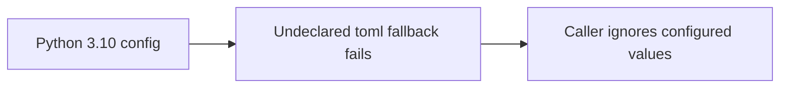

**After**

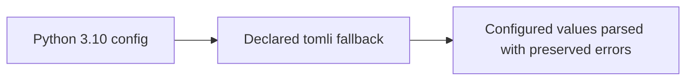

The earlier frozen 3.10/3.11/3.12 matrix passed 1,964 functional tests with 267
existing skips on each interpreter. Its coverage denominator was incomplete on
all three, so its percentages do not establish the release gate. The repaired
gate includes namespace modules and runs with INFO logging enabled.

Invalid explicit embedding chunk steps fail before iteration (#257). Document
callers can select positive small chunks without supplying overlap; the internal
default is normalized only for sizes at or below 200. Sizes above 200 retain their
previous behavior. Invalid HTTP sizes return 422. The subprocess regression uses
unbuffered byte output and requires both readiness and actual rejection evidence.
Credential
configuration logging uses proper format placeholders, preventing INFO-level
initialization failures (#258).

Pre-commit's install/run/update Make targets use an isolated UV tool environment
on Python 3.11 with fixed dependency floors. The dependency-audit Make/workflow
steps run pip-audit against a fresh frozen export without ignoring advisories;
the existing Bandit check remains. Runtime and test support
remain Python 3.10–3.12. Unused Beautiful Soup and Soup Sieve dependencies are
removed; no owning source or workflow imported them. Current security validation
uses the actual frozen dependency set for each interpreter, separately from the
historical Safety-only result above.

## Final release gate

The complete Linux matrix ran on code revision
`b696cf292a624d9b679f0ecb5d98d138933dcdc6`, with INFO logging enabled.

| Python | Passed | Existing skips | Whole-source coverage | Covered statements / total | Covered branches / total | Child exit |
|---|---:|---:|---:|---|---|---:|
| 3.10.20 | 2,046 | 267 | 50.327697% | 14,002 / 26,335 | 2,815 / 7,080 | 0 |
| 3.11.9 | 2,046 | 267 | 50.291785% | 13,994 / 26,335 | 2,811 / 7,080 | 0 |
| 3.12.13 | 2,046 | 267 | 50.327697% | 14,002 / 26,335 | 2,815 / 7,080 | 0 |

Each report includes all 217 owning Python files with zero missing or extra
files. The unchanged minimum is 50%. No new exclusions or skips were added.
The broader 84-module acceptance work in #178 remains open.

Frozen dependency exports audit clean on all three interpreters: 169 packages on
3.10, 166 on 3.11 and 163 on 3.12, with zero ignored advisories. The actual
isolated pre-commit and audit-tool environments also have zero known dependency
findings. A vulnerable Authlib control produces nine findings and a nonzero exit.
All applicable configured hooks pass on the complete 68-file change. Wheel and
sdist builds pass; each has 219 runtime package files, with no Git LFS pointers
and no byte differences from the source. Documentation-only followups retain
source/test/configuration/lock identity; the pull request records that receipt
separately from the matrix's tested revision.
