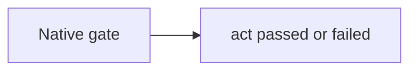
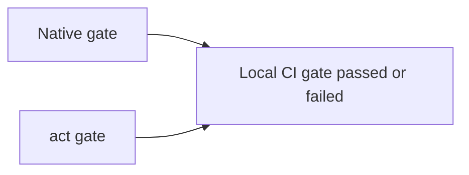

# 8.0.71

Fix CI completion messages that incorrectly called native validation an act run
(#262). PASS/FAIL, PR refusal and all exit codes retain their existing behavior.
No dependency or license-policy change is included; the separate dependency
candidate in #256 and its policy decision in #259 remain unresolved.

**Before**

**After**

The diff adds centralized runner-neutral messages and CLI regressions. Two cases
failed before the fix. The workflow suite passes 144 tests; the complete existing
suite passes 1,805 tests with 267 existing skips. Locked Black 25.12.0 and isort
5.13.2 validate the source. The local act attempt stalled fetching CodeQL's action
after a git-clone error and was stopped; it is not a passing act result.
