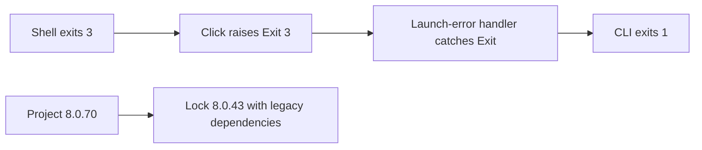
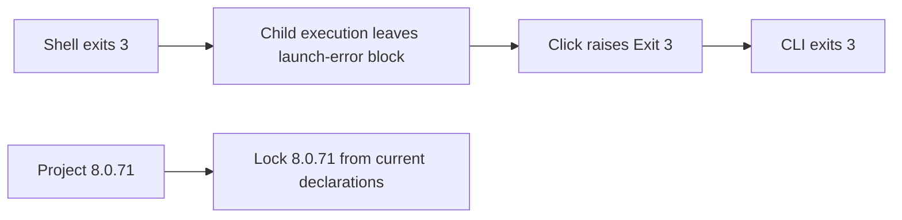
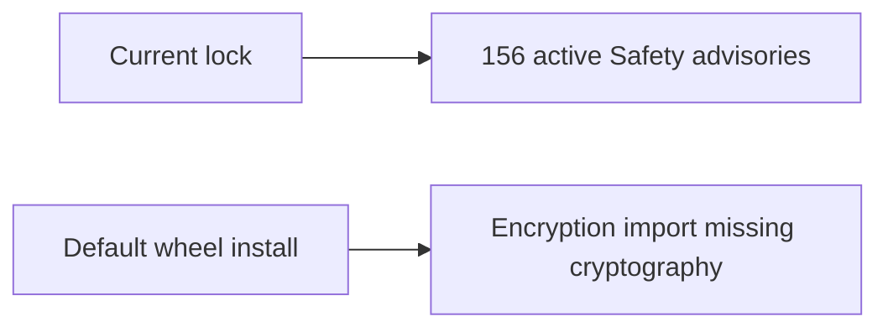
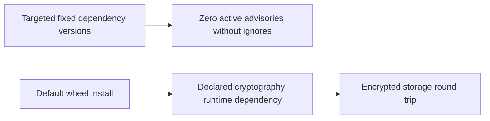
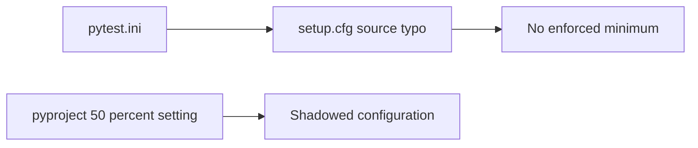
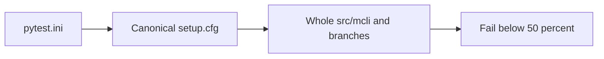
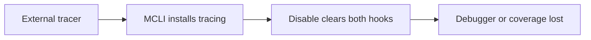
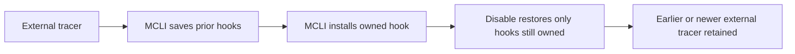

# Release Notes - Version 8.0.71

Release date: 2026-11-13

Shell workflows preserve their child process exit code in captured-output and
interactive execution (#249). A script that exits `3` now returns `3`, without
the misleading execution-error diagnostic. Process-launch failures still return
`1` with the existing diagnostic.

The lockfile is regenerated from the current declarations (#250), removing the
legacy ML/CUDA dependency graph. Its editable package version now matches the
release version. The initial metadata refresh used no upgrade resolution; the
security remediation below then applied named package upgrades.

**Before**

**After**

Changed: shell execution, regression tests, dependency security floors, package
metadata, Black formatting, release notes and installation documentation.

Security remediation (#251) updates the 19 packages reported by the project
Safety audit, plus FastAPI to support the fixed Starlette release. Runtime and
development dependency floors prevent resolution back to the audited vulnerable
versions. Black's supported range moves to 26.x; its formatting changes are
included. The release remains Python 3.10 compatible.

`cryptography` is now an explicit runtime dependency. Previously, installing the
default wheel without development extras left encrypted storage unusable. A
regression test builds and installs the wheel in a fresh environment, encrypts
and decrypts binary data, imports the secrets manager, and requests the MCLI API
health endpoint through the installed HTTP stack.

**Before**

**After**

The dependency repair is part of this release, beyond the lock metadata refresh.
Safety scanned 184 installed development-environment packages and reported zero
active advisories and zero ignored advisories. The full functional suite passed
1,810 tests with 267 skips. Python 3.10 frozen installation and focused storage,
API and shell tests also pass. The separate coverage requirement and final
integration release gates remain outstanding.

Coverage configuration repair (#252) makes `setup.cfg` the single coverage
configuration and `pytest.ini` the single pytest configuration. Plain pytest,
Make and CI coverage runs now select whole-package branch measurement and the
50% minimum. The old ordinary CI command did not enforce that minimum. The
existing exclusions and collected tests are preserved. New LSH transport tests
cover authentication, job requests, session ownership and event-handler failures.
This configuration repair does not establish that the release meets 50% coverage;
that acceptance requirement remains open under #178.

**Before**

**After**

The coverage harness also restores the prior interpreter and thread trace hooks
after logger tests. Previously, logger cleanup cleared coverage's hook and later
tests ran without measurement. A regression reproduces that loss and verifies
that teardown leaves an active collector attached.

Runtime tracing preserves external debugger and coverage hooks (#253). MCLI
saves the prior interpreter and thread hooks once when enabling tracing, then
restores each only if MCLI still owns it. Disabling tracing cannot overwrite a
new tracer that took ownership in the meantime. Five sentinel-hook regressions
cover no ownership, repeated enable/disable and independent hook replacement.

**Before**

**After**

Coverage checkpoint: 1,841 tests pass with 267 existing skips, but valid
whole-package branch coverage is 42.30% (12,395/29,305 combined items). The 50%
release gate correctly fails. Another 2,258 covered items are required under
#178; this release remains unpublished pending that acceptance work. The 60
focused coverage/logger/LSH regressions also pass on Python 3.10.
