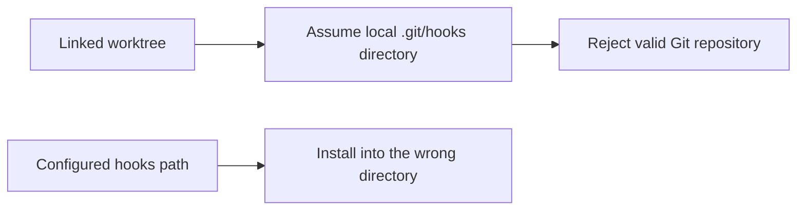
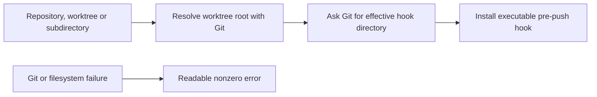

# 8.0.72 — Git worktree hook installation

`mcli ci install-hook` now resolves the hook directory through Git. It works from
linked worktrees and subdirectories, respects relative and absolute
`core.hooksPath`, creates a configured hook directory when needed, and reports
Git or filesystem failures through a nonzero Click error. Hook contents and CI
exit policy are unchanged. Fixes #260.

**Before**

**After**

Validation: linked worktree and both configured-path cases failed before the fix.
All 28 CI CLI cases pass. Full Python 3.10, 3.11 and 3.12 suites each pass 1,814
tests with 267 existing skips and 12 warnings; the final isolated Git fixtures pass
all 28 CLI cases again on each version. Source Black 25.12.0/isort 5.13.2 checks,
wheel build, installed-wheel CLI/version/help and linked-worktree hook installation
pass. Runtime audit: 78 third-party packages, no known vulnerabilities; all 79
installed packages are compatible. No dependency or license-policy change.

The first act attempt ran no jobs because self-hosted labels were unmapped. The
mapped attempt failed before tests while Podman copied actions/setup-python@v4
(`.eslintignore: path escapes from parent`). It is not a passing act result.
Native checks above are the affected-job fallback; Rust sources are untouched.
Evidence: /home/lefv/.local/state/mcli/8.0.72-release-2026-11-18/.
