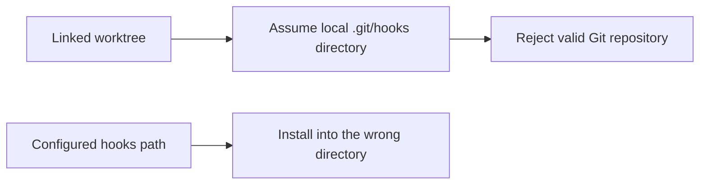
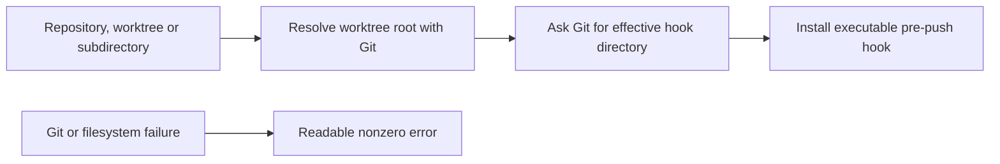

# 8.0.72 — Git worktree hook installation

Candidate: validation, merge and publication pending.

`mcli ci install-hook` now resolves the hook directory through Git. It works from
linked worktrees and subdirectories, respects relative and absolute
`core.hooksPath`, creates a configured hook directory when needed, and reports
Git or filesystem failures through a nonzero Click error. Hook contents and CI
exit policy are unchanged. Fixes #260.

**Before**

**After**

Regression evidence: linked worktree and both configured-path cases failed before
implementation; all 28 CI CLI cases then passed. Full supported-Python tests,
formatting, build and publication evidence will be recorded before release.
